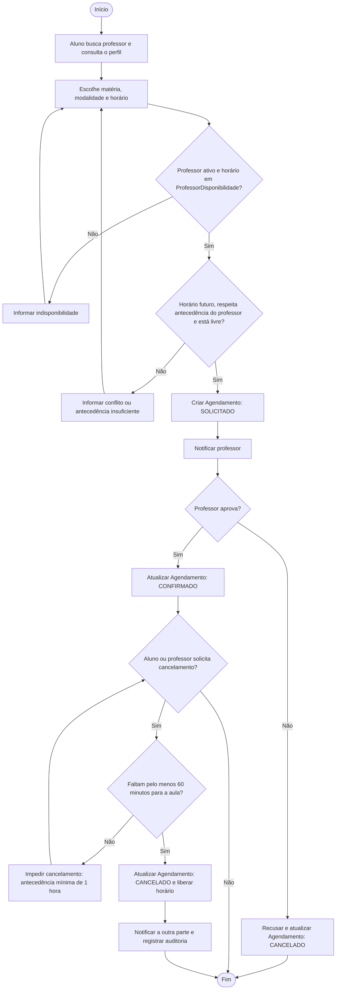
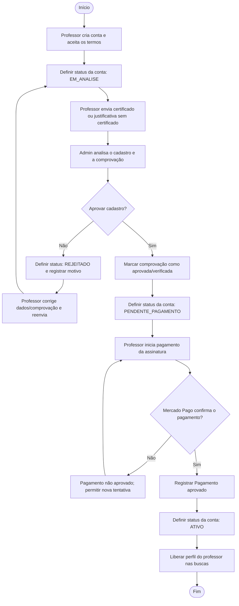
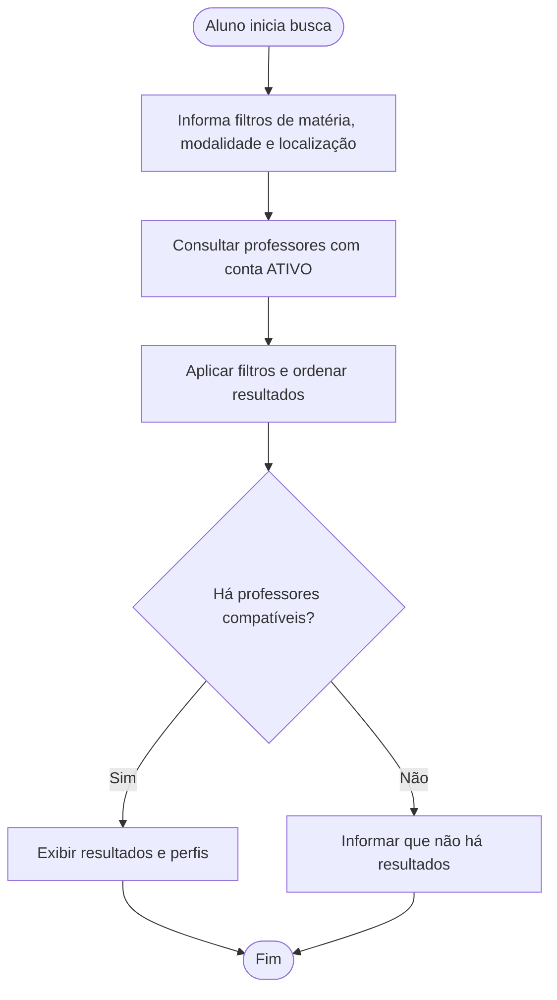
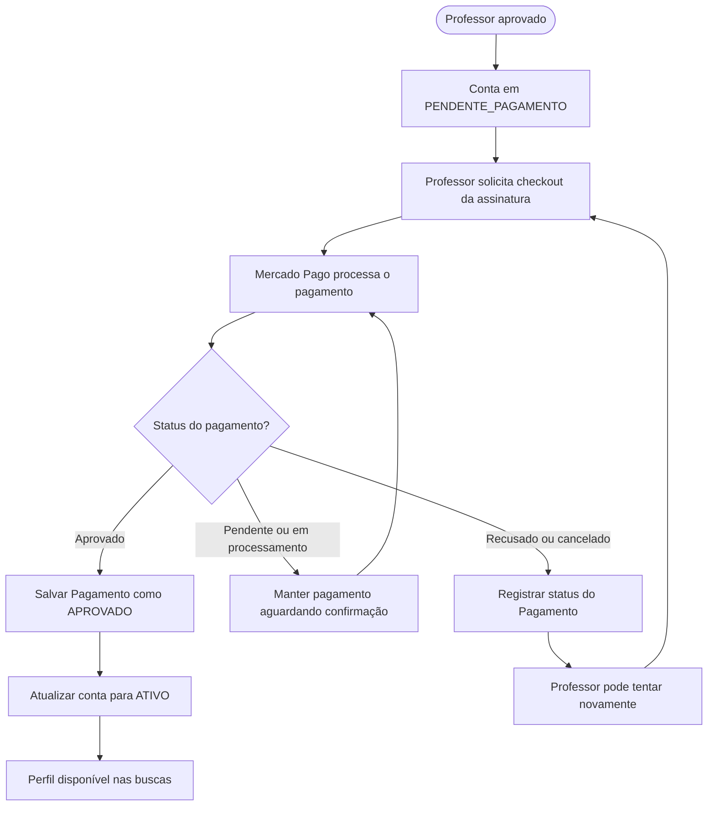
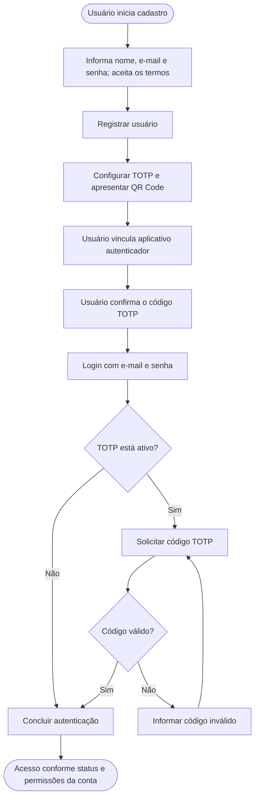
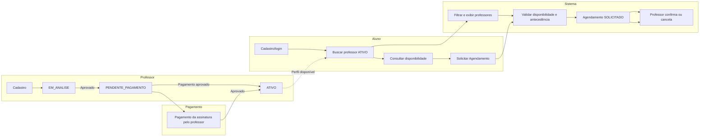
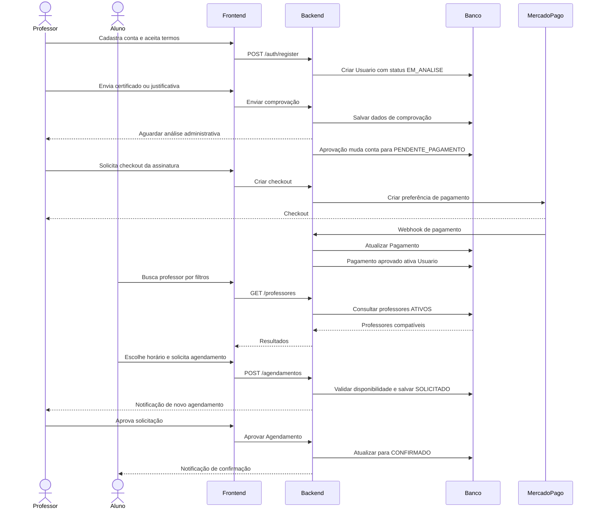
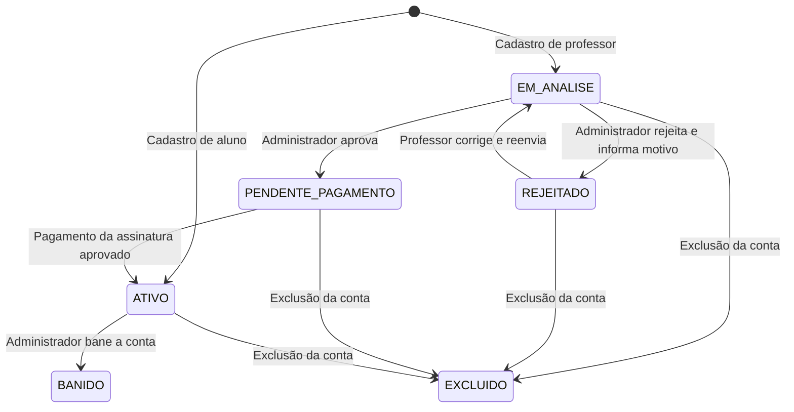
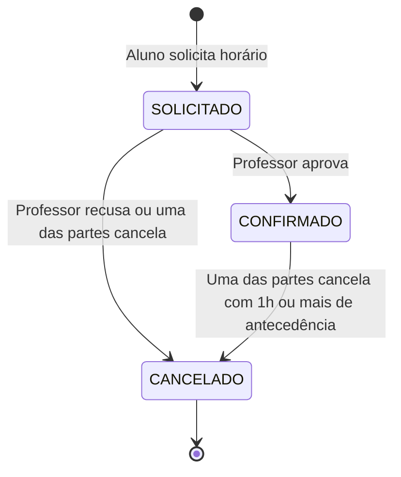

# 📊 Diagramas de processos — ConectaPro

Diagramas revisados conforme a implementação da branch `entrega1611`.

## 1. Processo de agendamento

O aluno escolhe um professor ativo, matéria, modalidade e horário disponível. O sistema valida o horário, a antecedência mínima configurada pelo professor e se o horário já está ocupado. O agendamento começa como `SOLICITADO`; o professor pode confirmar ou recusar. Aluno ou professor podem cancelar, desde que faltem pelo menos 60 minutos para o início.

**Mudança:** o fluxo não inclui cobrança do aluno; acrescenta a regra de cancelamento com uma hora de antecedência e usa `Agendamento`/`ProfessorDisponibilidade`.

---

## 2. Processo de configuração, análise e assinatura do professor

**Mudança:** a análise do administrador e o envio de certificado ou justificativa antecedem o pagamento; reprovação informa o motivo e permite reenvio.

---

## 3. Processo de busca e filtro

**Mudança:** removi a afirmação de assinatura em dia como entidade/status separado; a elegibilidade de busca é expressa por `StatusConta.ATIVO`.

---

## 4. Pagamento da assinatura do professor

### 4.1. Checkout e confirmação

**Mudança:** o diagrama representa apenas o `Pagamento` da assinatura do professor, sem entidades de plano/assinatura, renovação de mensalidade ou pagamento de aula pelo aluno.

---

## 5. Autenticação com 2FA (TOTP)

**Mudança:** explicitei o aceite dos termos no cadastro; o fluxo de TOTP foi mantido, com os nomes atualizados.

---

## 6. Visão geral dos processos

**Mudança:** removi split, taxa da plataforma e pagamento pelo aluno; o único pagamento representado é o da assinatura do professor.

---

## 7. Sequência de interações

**Mudança:** atualizei a sequência para aprovação do professor, `POST /agendamentos` e confirmação pelo professor; removi checkout/split da aula.

---

## Matriz de responsabilidades (RACI)

| Atividade | Aluno | Professor | Administrador | Sistema | Mercado Pago | AWS S3 |
| --- | --- | --- | --- | --- | --- | --- |
| Criar conta e aceitar termos | R | R |  | A |  |  |
| Enviar certificado/justificativa |  | R |  | A |  | ✓ |
| Analisar e aprovar/rejeitar cadastro |  |  | R | A |  |  |
| Pagar assinatura |  | R |  | A | ✓ |  |
| Buscar professores e solicitar agendamento | R |  |  | A |  |  |
| Confirmar ou cancelar agendamento |  | R |  | A |  |  |
| Registrar mensagens, denúncias e notificações | R | R |  | A |  |  |
| Consultar auditoria/moderação |  |  | R | A |  |  |

**R = Responsável | A = Accountable (responsável final)**

**Mudança:** removi a linha de pagamento de aula/split e acrescentei análise de professor, moderação e suporte.

---

## Estados possíveis no sistema

### Status da conta

### Status do agendamento

**Mudança:** substituí estados antigos de assinatura e reserva pelos estados reais `StatusConta` e `StatusAgendamento`, incluindo `EXCLUIDO` que também existe no enum.

---

## Caso de uso principal: solicitar aula

**Atores:** aluno, professor e sistema ConectaPro.

**Pré-condições:** aluno autenticado; professor com conta `ATIVO`; professor com matéria, modalidade e horário disponíveis.

**Fluxo principal:**
1. Aluno busca professor por filtros e consulta seu perfil.
2. Aluno escolhe matéria, modalidade e horário.
3. Sistema valida que o horário está em `ProfessorDisponibilidade`, está livre, é futuro e respeita a antecedência mínima configurada pelo professor.
4. Sistema cria `Agendamento` com status `SOLICITADO` e notifica o professor.
5. Professor aprova; sistema muda o status para `CONFIRMADO` e notifica o aluno.
6. Qualquer uma das partes pode cancelar com no mínimo uma hora de antecedência; o sistema muda o status para `CANCELADO`, libera o horário e notifica a outra parte.

**Pós-condições:** o agendamento fica em `CONFIRMADO` ou `CANCELADO`; nenhum pagamento de aula é cobrado pela plataforma.

**Mudança:** retirei pagamento do aluno e contratação B2B/split; descrevi a validação, aprovação e cancelamento conforme o fluxo de agendamento.

---

## Notas técnicas

- Autenticação com JWT e TOTP (2FA).
- Papéis definidos no modelo: `ALUNO`, `PROFESSOR` e `ADMIN`.
- Pagamento persistido em `Pagamento`; o checkout é da assinatura do professor.
- Entidades de agendamento: `Agendamento` e `ProfessorDisponibilidade`.
- Estados de agendamento: `SOLICITADO`, `CONFIRMADO` e `CANCELADO`.
- Estados de conta incluem `EM_ANALISE`, `REJEITADO`, `PENDENTE_PAGAMENTO`, `ATIVO`, `EXCLUIDO` e `BANIDO`.
- Cancelamento de agendamento exige pelo menos uma hora de antecedência.
