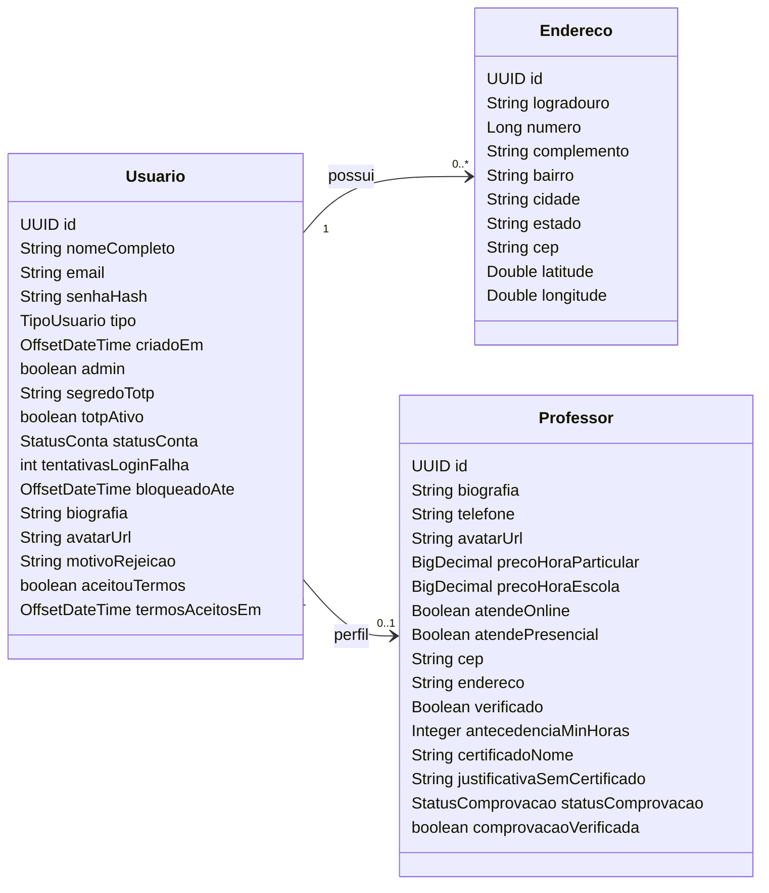
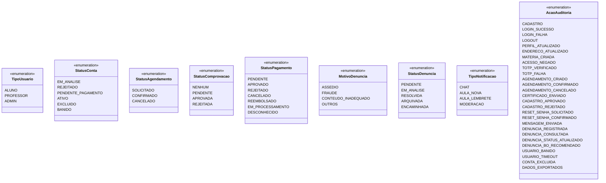
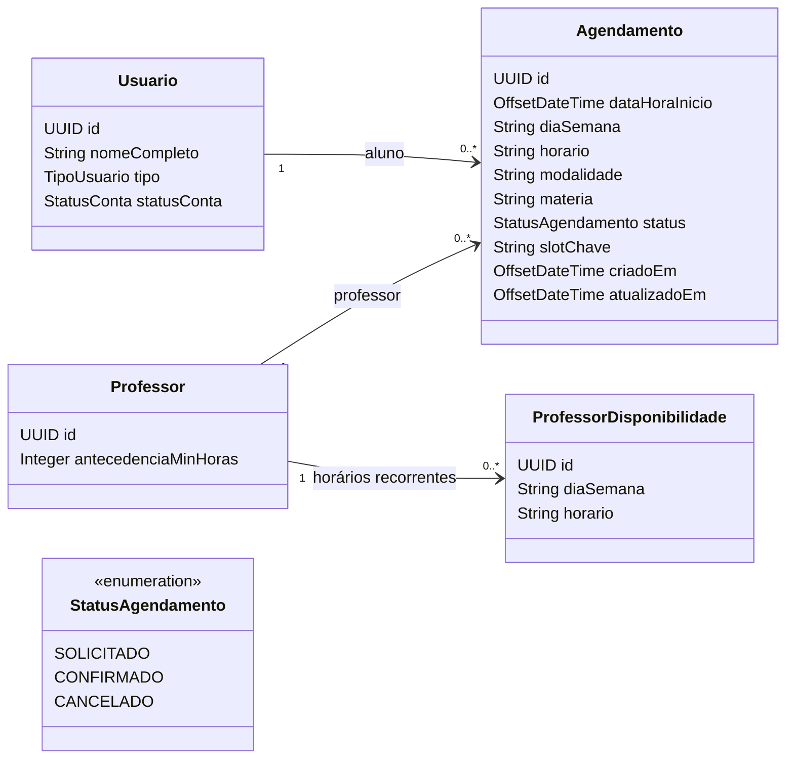
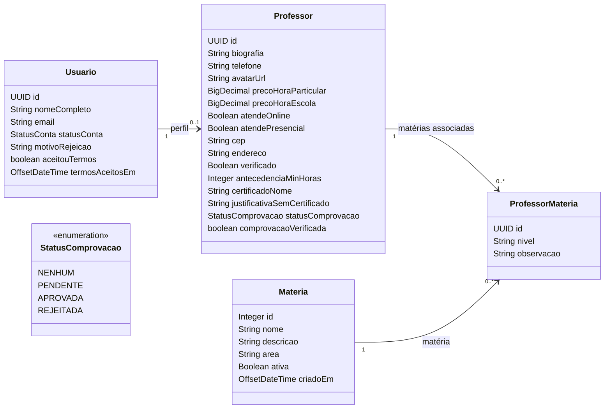
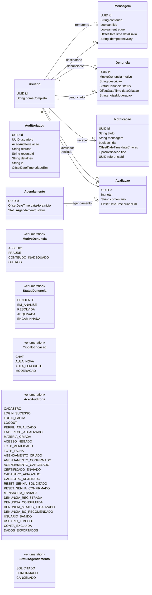
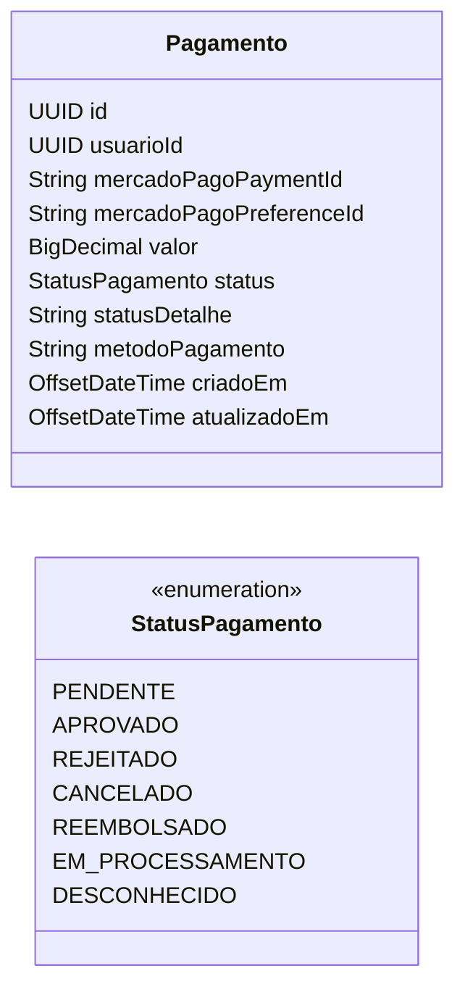

# Diagramas de classes — ConectaPro

Diagramas conforme entidades e enums de `src/main/java/com/grupo/tfc/conectapro/model/` na branch `entrega1611`.

## Figura 2 — Diagrama geral

```mermaid
classDiagram
direction LR

class Usuario {
  UUID id
  String nomeCompleto
  String email
  String senhaHash
  TipoUsuario tipo
  OffsetDateTime criadoEm
  boolean admin
  String segredoTotp
  boolean totpAtivo
  StatusConta statusConta
  int tentativasLoginFalha
  OffsetDateTime bloqueadoAte
  String biografia
  String avatarUrl
  String motivoRejeicao
  boolean aceitouTermos
  OffsetDateTime termosAceitosEm
}
class Endereco {
  UUID id
  String logradouro
  Long numero
  String complemento
  String bairro
  String cidade
  String estado
  String cep
  Double latitude
  Double longitude
}
class Professor {
  UUID id
  String biografia
  String telefone
  String avatarUrl
  BigDecimal precoHoraParticular
  BigDecimal precoHoraEscola
  Boolean atendeOnline
  Boolean atendePresencial
  String cep
  String endereco
  OffsetDateTime criadoEm
  OffsetDateTime atualizadoEm
  Boolean verificado
  Integer antecedenciaMinHoras
  String certificadoNome
  String justificativaSemCertificado
  StatusComprovacao statusComprovacao
  boolean comprovacaoVerificada
}
class ProfessorDisponibilidade {
  UUID id
  String diaSemana
  String horario
}
class Agendamento {
  UUID id
  OffsetDateTime dataHoraInicio
  String diaSemana
  String horario
  String modalidade
  String materia
  StatusAgendamento status
  String slotChave
  OffsetDateTime criadoEm
  OffsetDateTime atualizadoEm
}
class Materia {
  Integer id
  String nome
  String descricao
  String area
  Boolean ativa
  OffsetDateTime criadoEm
}
class ProfessorMateria {
  UUID id
  String nivel
  String observacao
}
class Pagamento {
  UUID id
  UUID usuarioId
  String mercadoPagoPaymentId
  String mercadoPagoPreferenceId
  BigDecimal valor
  StatusPagamento status
  String statusDetalhe
  String metodoPagamento
  OffsetDateTime criadoEm
  OffsetDateTime atualizadoEm
}
class Mensagem {
  UUID id
  String conteudo
  boolean lida
  boolean entregue
  OffsetDateTime dataEnvio
  String idempotencyKey
}
class Denuncia {
  UUID id
  MotivoDenuncia motivo
  String descricao
  StatusDenuncia status
  OffsetDateTime dataCriacao
  String notasModeracao
}
class Notificacao {
  UUID id
  String titulo
  String mensagem
  boolean lida
  OffsetDateTime dataCriacao
  TipoNotificacao tipo
  UUID referenciaId
}
class Avaliacao {
  UUID id
  int nota
  String comentario
  OffsetDateTime criadoEm
}
class AuditoriaLog {
  UUID id
  UUID usuarioId
  AcaoAuditoria acao
  String recurso
  String recursoId
  String detalhes
  String ip
  OffsetDateTime criadoEm
}

class TipoUsuario {
  <<enumeration>>
  ALUNO
  PROFESSOR
  ADMIN
}
class StatusConta {
  <<enumeration>>
  EM_ANALISE
  REJEITADO
  PENDENTE_PAGAMENTO
  ATIVO
  EXCLUIDO
  BANIDO
}
class StatusAgendamento {
  <<enumeration>>
  SOLICITADO
  CONFIRMADO
  CANCELADO
}
class StatusComprovacao {
  <<enumeration>>
  NENHUM
  PENDENTE
  APROVADA
  REJEITADA
}
class StatusPagamento {
  <<enumeration>>
  PENDENTE
  APROVADO
  REJEITADO
  CANCELADO
  REEMBOLSADO
  EM_PROCESSAMENTO
  DESCONHECIDO
}
class MotivoDenuncia {
  <<enumeration>>
  ASSEDIO
  FRAUDE
  CONTEUDO_INADEQUADO
  OUTROS
}
class StatusDenuncia {
  <<enumeration>>
  PENDENTE
  EM_ANALISE
  RESOLVIDA
  ARQUIVADA
  ENCAMINHADA
}
class TipoNotificacao {
  <<enumeration>>
  CHAT
  AULA_NOVA
  AULA_LEMBRETE
  MODERACAO
}
class AcaoAuditoria {
  <<enumeration>>
  CADASTRO
  LOGIN_SUCESSO
  LOGIN_FALHA
  LOGOUT
  PERFIL_ATUALIZADO
  ENDERECO_ATUALIZADO
  MATERIA_CRIADA
  ACESSO_NEGADO
  TOTP_VERIFICADO
  TOTP_FALHA
  AGENDAMENTO_CRIADO
  AGENDAMENTO_CONFIRMADO
  AGENDAMENTO_CANCELADO
  CERTIFICADO_ENVIADO
  CADASTRO_APROVADO
  CADASTRO_REJEITADO
  RESET_SENHA_SOLICITADO
  RESET_SENHA_CONFIRMADO
  MENSAGEM_ENVIADA
  DENUNCIA_REGISTRADA
  DENUNCIA_CONSULTADA
  DENUNCIA_STATUS_ATUALIZADO
  DENUNCIA_BO_RECOMENDADO
  USUARIO_BANIDO
  USUARIO_TIMEOUT
  CONTA_EXCLUIDA
  DADOS_EXPORTADOS
}

Usuario "1" --> "0..*" Endereco : possui
Usuario "1" --> "0..1" Professor : perfil de professor
Professor "1" --> "0..*" ProfessorDisponibilidade : disponibilidade
Professor "1" --> "0..*" ProfessorMateria : leciona
Materia "1" --> "0..*" ProfessorMateria : disciplina
Usuario "1" --> "0..*" Agendamento : aluno
Professor "1" --> "0..*" Agendamento : professor
Usuario "1" --> "0..*" Mensagem : remetente
Usuario "1" --> "0..*" Mensagem : destinatario
Usuario "1" --> "0..*" Denuncia : denunciante
Usuario "1" --> "0..*" Denuncia : denunciado
Usuario "1" --> "0..*" Notificacao : recebe
Usuario "1" --> "0..*" Avaliacao : avaliador
Usuario "1" --> "0..*" Avaliacao : avaliado
Agendamento "1" --> "0..*" Avaliacao : agendamento
```

**Mudança:** inclui as entidades e campos atuais, e substitui `Reserva` por `Agendamento`; o financeiro contém somente `Pagamento`.

## Figura 3 — Contas

**Mudança:** acrescentei aceite de termos, estado e motivo de rejeição em `Usuario`, e comprovação em `Professor`.

## Figura 4 — Enums

**Mudança:** enumerei os valores presentes na branch, incluindo `EXCLUIDO` em `StatusConta` e os estados reais de agendamento.

## Figura 5 — Agendamento

**Mudança:** substituí disponibilidade antiga por `ProfessorDisponibilidade`; o vínculo usa `Agendamento` e os estados `SOLICITADO`, `CONFIRMADO` e `CANCELADO`.

## Figura 6 — Perfil

**Mudança:** adicionei dados de certificado e justificativa ao perfil, bem como o estado de comprovação.

## Figura 7 — Suporte

**Mudança:** incluí `Mensagem`, `Denuncia`, `Notificacao` e `Avaliacao`, com as relações de participantes e agendamento.

## Figura 8 — Financeiro

**Mudança:** o diagrama financeiro contém somente `Pagamento`; representa o pagamento da assinatura pelo professor, sem `Reserva`, `SplitPagamento`, pagamento de aula, plano ou entidade `Assinatura`.
